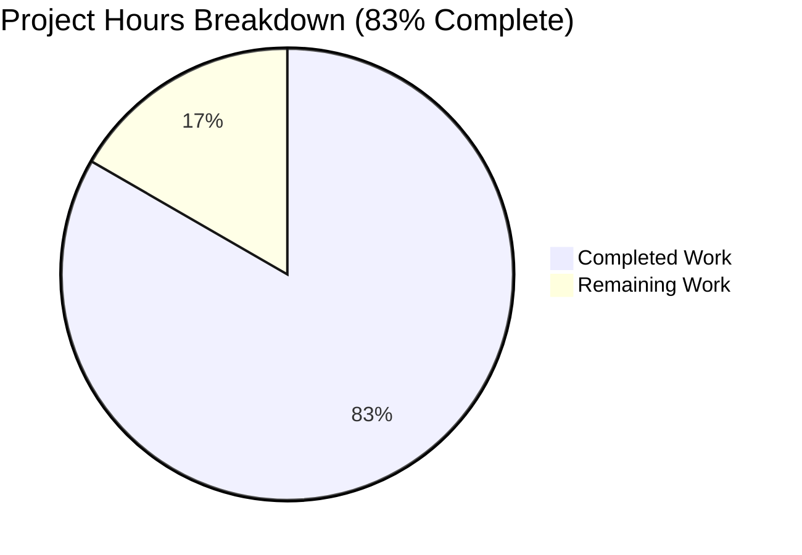

# 1. Executive Summary

## 1.1 Project Overview

This project delivers a two-file, zero-dependency fixture: `main.py`, a one-line Python 3 program whose entire standard output is the string `Welcome to Blitzy` followed by a single line feed, and `hello_world.txt`, that same line committed 95000 times as literal content — 95000 lines, 1710000 bytes, one distinct line. It exists for the requester and for any evaluator who opens the two files and checks the string, the count and the digests. There is no service, no user interface, no configuration, no build step and no deployment; the product ships as a commit, runs wherever Python 3 exists, and is proven by command output rather than by a test suite.

## 1.2 Completion Status



Brand colour mapping used throughout this guide: Completed = Dark Blue (`#5B39F3`), Remaining = White (`#FFFFFF`), headings and accents = Violet-Black (`#B23AF2`), highlight = Mint (`#A8FDD9`). A Mermaid pie chart renders its own segment palette, so the mapping is stated here and in Section 7 rather than encoded in the diagram.

| Metric | Hours | Basis |
|---|---|---|
| **Total Hours** | 12.0 | Everything the specification scopes: the two deliverables, their literal provenance and byte-stable definitions, the acceptance battery, and the remaining commit work |
| **Completed Hours (AI + Manual)** | 10.0 | The six completed components in Section 2.1 |
| **Remaining Hours** | 2.0 | The two remaining items in Section 2.2 |
| **Completion** | 83% | (10.0 ÷ (10.0 + 2.0)) × 100 = 83.3%, stated as 83% |

## 1.3 Key Accomplishments

- ✅ **Print program** — `python3 main.py` writes exactly one line, `Welcome to Blitzy`, terminated by a single LF: 18 bytes on stdout, empty stderr, exit status 0 (`main.py:1`).
- ✅ **Minimal source held at the floor** — 1 line, 27 bytes, one statement, one call, one string literal, no import, no shebang, no comment; sha256 `79ad31b9…6360`.
- ✅ **Data artifact delivered as content** — 95000 LF-terminated occurrences, one occurrence per line, 95000 lines, 1710000 bytes, exactly one distinct line; sha256 `359227ba…183f` (`hello_world.txt`, commit `bf89251`).
- ✅ **Literal provenance** — no generator, template, build step, hook or CI job exists anywhere in the tree or in history; only three paths were ever added.
- ✅ **Deliverables decoupled** — the program contains no file API and never opens, reads or writes the data file; the artifact's digest is unchanged across repeated runs.
- ✅ **Zero dependencies, zero configuration** — no manifest, lockfile, virtual environment or install step; no environment variable or secret is read; the program is unaffected by arguments, locale, environment or working directory.
- ✅ **Repository reduced to exactly the two deliverables** — `git ls-files` returns `hello_world.txt` and `main.py` and nothing else.
- ✅ **Byte-stability guard in place** — both stated digests reproduce in the working tree and from the committed blobs, with `core.autocrlf` and `core.eol` unset and no `.gitattributes` in play.

## 1.4 Critical Unresolved Issues

Two items are open: one of the sixteen acceptance checks the specification fixes does not reproduce at the delivered tip, and one clause inside that same check cannot be satisfied by any repository state.

| Issue | Impact | Owner | ETA |
|---|---|---|---|
| The delivered tip commit names neither deliverable, so the specification's own acceptance check `git show --stat HEAD` yields no evidence of the product. `HEAD` (`0820699`) removes the pre-existing 45-byte `README.md` from the initial commit, while the two deliverables were added by earlier commits (`337b471`, `bf89251`) and no commit in the ancestry names both | Blocks the definition of done and any gate that runs that check literally. No product byte is affected: both blobs sit in `HEAD`'s tree at 27 and 1710000 bytes with their stated digests | Repository owner | 1.5 h of additive commit work, same day |
| The byte-size clause inside that same check (`hello_world.txt` at 1710000 bytes, read from `git show --stat HEAD` output) is unsatisfiable by any repository state, because `git show --stat` prints changed line counts for a text file | A literal gate run can never pass that clause; judge the size from the committed blob instead (`git cat-file -s HEAD:hello_world.txt` = 1710000) | Specification owner | A documentation decision, no code change |

## 1.5 Access Issues

No credential, service or third-party access is needed to build, run or verify the product: there is nothing to install, no environment variable and no secret. One access item is required to close the work in Section 2.2.

| System/Resource | Type of Access | Issue Description | Resolution Status | Owner |
|---|---|---|---|---|
| Delivery branch `blitzy-16543f7e-fd81-4199-ad8e-93b55972d1cc` | Git push (write) | Land the composed tip that introduces both deliverables in one commit. Building, running and verifying the product locally needs no access of any kind; only landing the commit does | Open — required to close the release-blocking item in Section 1.4 | Repository owner |

## 1.6 Recommended Next Steps

1. **[High]** Compose the delivered tip so a single commit at `HEAD` introduces both deliverables and nothing else, reusing the existing blobs (`4ca03ebe…` for `main.py`, `32c3e473…` for `hello_world.txt`) without regenerating either file. Additive only: no amend, rebase, force-push, restored scaffold file or added file.
2. **[High]** Re-run the acceptance battery at that tip and confirm the tip's change set names both deliverables, `git ls-files` still lists exactly the two files, the change set against the initial commit is unchanged, and both digests and sizes are untouched.
3. **[Medium]** Decide how the byte-size clause of the acceptance check is judged — accept the equivalent evidence from the committed blob, or amend the check's wording. No code change settles it.
4. **[Medium]** Confirm the repository should continue to hold exactly the two product files, with the pre-existing 45-byte scaffold file remaining removed (it is preserved in history at `5eaa184`).
5. **[Low]** Adopt the sixteen-row acceptance battery as the release guard for the fixed values, comparing digests rather than line counts, since no test file or CI job may be added.

# 2. Project Hours Breakdown

## 2.1 Completed Work Detail

| Component | Hours | Description |
|---|---|---|
| Program source and stdout contract | 1.5 | `main.py` authored to its exact bytes — one statement, no import, no shebang, mode 100644 — and its runtime contract confirmed: one line, 18 bytes, empty stderr, exit status 0 (FR-1, FR-2, NFR-1, §0.5.1 rows 1–2, §0.5.4, §0.6.1 Component A) |
| Data artifact production and content specification | 2.5 | `hello_world.txt` produced once as literal content outside the checkout; byte discipline enforced (LF after every occurrence including the last, no CR, no BOM, no blank line); 95000 lines, 1710000 bytes and one distinct line verified (FR-3, FR-5, NFR-2, NFR-5, §0.5.1 rows 3 and 5, §0.5.2, §0.6.1 Component B) |
| Literal provenance and deliverable decoupling | 1.5 | No producer persisted, referenced or committed; the repetitions held as a 1710000-byte content blob; the program shown never to touch the artifact (no file API in the source; artifact digest unchanged across repeated runs) (FR-4, §0.5.3) |
| Byte-stable definitions, terminator policy and digests | 1.0 | Both digests fixed and stated, the LF terminator policy recorded including the trailing terminator, the line-ending hazard assessed with the digest as the designated guard and no `.gitattributes` added (§0.5.2, NFR-3) |
| Acceptance battery and evidence against the committed tree | 2.5 | The sixteen-row command battery run against the committed files, plus determinism across repeated runs, invariance under arguments, stdin, working directory, environment, locale and interpreter flags, and adversarial content sweeps (§0.5.5 rows 1–15 and the two evidence rules, §0.12.1 directive 5, §0.12.2 reproducibility) |
| Two-file repository structure and scope discipline | 1.0 | Tracked tree reduced to exactly the two deliverables at the root; every excluded artefact confirmed absent — no test, document, manifest, packaging, container, CI, dotfile, linter config, second data file or large-file mechanism (§0.7.1, §0.7.2, §0.8.2, §0.9.1) |
| **Total** | **10.0** | Matches Completed Hours in Section 1.2 |

## 2.2 Remaining Work Detail

| Category | Hours | Priority |
|---|---|---|
| Compose the delivered tip so one commit introduces both deliverables and nothing else, closing the failing clause of §0.5.1 rows 4 and 6, §0.5.5 row 16 and §0.12.1's "in one commit" | 1.5 | High |
| Re-run the acceptance battery at the composed tip and record it — tip change set, `git ls-files`, change set against the initial commit, both digests and both sizes (§0.12.2 definition of done) | 0.5 | High |
| **Total** | **2.0** | Matches Remaining Hours in Section 1.2 and the "Remaining Work" value in Section 7 |

Both rows are additive git work on the existing objects. They change no product byte: `main.py` stays 27 bytes at sha256 `79ad31b9…6360` and `hello_world.txt` stays 1710000 bytes at sha256 `359227ba…183f`. Two further items need a human decision but no engineering hours: how the acceptance check's unreachable byte-size clause is judged (Section 5.2, D4), and whether the repository should continue to hold exactly the two product files with the pre-existing scaffold left removed (D2, D3).

## 2.3 Hour Calculation and Confidence

Completion is measured only over what the specification scopes: the two deliverables, their provenance and byte-stable definitions, the acceptance battery that proves them, and the commit work still outstanding. Nothing outside that scope carries hours — the absent test suite, documentation, manifests, containers and CI are requirements, not omissions, so their absence is worth zero hours in either direction.

**Formula with actual numbers:** Completion % = Completed Hours ÷ (Completed Hours + Remaining Hours) × 100 = 10.0 ÷ (10.0 + 2.0) × 100 = 83.3%, stated as **83%**. Total project hours = 12.0, and Section 2.1 + Section 2.2 = 10.0 + 2.0 = 12.0.

| Estimate | Confidence | Basis |
|---|---|---|
| Completed work (10.0 h) | High | Every row traces to artefacts measured in the checkout: file bytes, blob identities, digests, command output |
| Tip composition (1.5 h) | High | The technique is purely additive and already proven in the repository's own history; it reuses existing blobs and regenerates nothing |
| Re-verification (0.5 h) | High | The sixteen-row battery and the repository checks are deterministic and run in seconds |

# 3. Test Results

The product ships with no test suite and the specification forbids authoring one for the fixed values, so its assurance is the sixteen-row acceptance battery, run against the files as committed. The table below aggregates what was executed in this checkout, by area, with the totals observed. Results are stated as of the delivered tip.

| Area / Category | Framework | Tests | Passed | Failed | Coverage | What This Proves |
|---|---|---|---|---|---|---|
| Print program — runtime contract | POSIX shell command battery | 4 | 4 | 0 | 18/18 output bytes | The program writes exactly the fixed line, nothing else, and exits cleanly |
| Print program — invocation invariance | POSIX shell command battery | 5 | 5 | 0 | 5/5 invocation forms | Output and status are unchanged by interpreter flags, an empty environment, disabled site packages, bytecode suppression and the working directory |
| Print program — source specification | POSIX shell command battery | 7 | 7 | 0 | 1/1 line; 27/27 bytes | The source is byte-exact and minimal, with no import, shebang, comment or executable bit, and no coupling to the data file |
| Data artifact — content and count | POSIX shell command battery | 6 | 6 | 0 | 95000/95000 lines; 1710000/1710000 bytes | The file holds the fixed line 95000 times, one occurrence per line, and nothing else |
| Data artifact — byte discipline | POSIX shell command battery | 5 | 5 | 0 | all 1710000 bytes | Terminators and encoding are exactly as specified: LF after every line including the last, no CR, no byte-order mark, no blank line |
| Data artifact — integrity against the committed object | POSIX shell command battery | 5 | 5 | 0 | 2/2 files byte-identical to their committed blobs | What is committed is what gets checked out, at the stated digests and sizes |
| Repository tree, change set and commit provenance | git | 5 | 5 | 0 | 2/2 tracked paths | The repository holds exactly the two deliverables, the change set against the initial commit is as specified, and the working tree is clean |
| Acceptance evidence at the tip commit | git | 1 | 0 | 1 | 15/16 acceptance rows | The delivered tip's change set does not name the deliverables, so the check that proves they are committed as content does not read true — the open item in Section 1.4 |
| **Total** | — | **38** | **37** | **1** | — | — |

**Not Covered**

- **No automated suite exists and none may be added.** Nothing in the repository re-checks the 95000 count or either digest, so the battery above is the project's only guard and must be re-run by hand or by the consumer's own harness. A single appended byte would be caught only by re-running it — the stated digests are the durable control.
- **The program's write-failure paths are uncovered.** When the output device cannot accept the write — a full device, or a consumer that closes the pipe immediately — the process ends with a non-zero status and an interpreter message. Error handling and exit-code design beyond the default are out of scope by specification, so no behaviour is specified and none is claimed; a harness should capture stdout to a file or consume all 18 bytes.
- **Terminal rendering is not counted as a byte check.** A terminal translates LF to CRLF downstream of the program's single write, so a byte count taken on a terminal reads one byte high. Byte checks must run on a redirected or piped stream.
- **No surface of the kind exists for UI, API, database, service or network testing.** The product has no screen, route, schema, listener or outbound call, and no code path opens the data file — it is inert committed content by design, read by tools and people rather than by the program.

# 4. Runtime Validation & UI Verification

Everything below was driven in this checkout against the delivered files.

- ✅ **Program start-up and exit** — `python3 main.py` from the repository root: exit status 0, one line on standard output, standard error empty.
- ✅ **Standard-output contract** — stdout is exactly 18 bytes: the 17-character string plus one LF, byte-for-byte identical to the fixed literal, with no colour, prefix, suffix or second line.
- ✅ **Invocation invariance** — identical output and status under `-B`, `-S` (site packages disabled) and a completely empty environment, from the checkout root and by absolute path, and with `./main.py` correctly refused (exit 126: no shebang, no executable bit — the fixed invocation is `python3 main.py`).
- ✅ **Determinism** — repeated runs produce a single output digest (`2dc7e85a…1951`); no run-to-run variation, no state carried between runs.
- ✅ **Working-tree hygiene** — after the full battery the tree is clean (`git status --porcelain --untracked-files=all` empty), exactly two files exist outside `.git`, and no bytecode or output file was created.
- ✅ **Data artifact delivery** — the committed blob is byte-identical to the working-tree copy, at 1710000 bytes and digest `359227ba…183f`; the file is ASCII text with 95000 LF terminators, no CR, no byte-order mark and one distinct line.
- ✅ **Repository boundary** — `git ls-files` lists exactly the two deliverables; `git ls-tree -r -l HEAD` reports 27 and 1710000 bytes with modes 100644; the change set against the initial commit is `D README.md`, `A hello_world.txt`, `A main.py`.
- ⚠ **Acceptance evidence at the delivered tip** — `git show --stat HEAD` names neither deliverable, because the tip commit's change set is the removal of the pre-existing `README.md`; the acceptance check that proves the deliverables are committed as content therefore does not read true (Section 1.4), although `git ls-tree -r -l HEAD` shows both blobs at their stated sizes and digests.
- ❌ **User interface and browser surface** — none exists: no screen, markup, route, stylesheet, asset or rendered page, so no UI flow could be driven and no screenshot or recording was produced.
- ❌ **Services, databases and outbound integrations** — none exist: the product listens on no port, stores nothing, queries nothing and makes no network call, so there was nothing to start for it.

Two things were therefore never exercised at runtime, and neither is a gap in the delivery. The data file has no runtime consumer by design — no code path opens it, so it is proven as committed content (counts, bytes, digest from the checkout and from the git objects) rather than by driving it. And the program's behaviour on a failing output device is unspecified: the specification places error handling and exit-code design out of scope, so no requirement covers it and none is claimed.

# 5. Compliance & Quality Review

## 5.1 Compliance Matrix

| # | Deliverable / Requirement | Status | Progress | How It Stands Now |
|---|---|---|---|---|
| 1 | Print program — exact source bytes (FR-1, FR-2, §0.5.4) | ✅ Pass | 100% | `main.py` is one statement plus one LF: 1 line, 27 bytes, sha256 `79ad31b9…6360`, mode 100644, no import or shebang |
| 2 | Program stdout contract — 18 bytes, empty stderr, exit 0 (NFR-1, §0.3.3) | ✅ Pass | 100% | Observed: one line, 18 bytes, byte-identical to the literal, 0 bytes on stderr, exit status 0, unchanged under every invocation form tried |
| 3 | Minimal-source and token floor (FR-2, §0.5.4) | ✅ Pass | 100% | One statement, one call, one string literal, zero keyword arguments, zero imports — nothing removable without breaking the file |
| 4 | Data artifact content, count and name (FR-3, FR-5, NFR-2, §0.5.2) | ✅ Pass | 100% | `hello_world.txt`: 95000 lines, 95000 anchored matches, 1710000 bytes, exactly one distinct line, no header, footer or blank line |
| 5 | Data artifact terminator policy and encoding (NFR-5, §0.5.2) | ✅ Pass | 100% | LF after every occurrence including the last, last byte `0a`, zero CR bytes, no byte-order mark; every one of the 1710000 bytes drawn from the fixed string plus LF |
| 6 | Literal provenance — committed content, no generator (FR-4, §0.5.3) | ✅ Pass | 100% | The repetitions exist as a 1710000-byte content blob; no generator, template, make target, hook or CI job exists in the tree or in any commit |
| 7 | Deliverable decoupling (§0.5.3, §0.6.1) | ✅ Pass | 100% | The program names no path and holds no file API; the artifact's digest is unchanged after repeated runs — neither artefact is the means by which the other is produced or consumed |
| 8 | Zero dependencies and configuration-free run (NFR-4, §0.4.1, §0.7.2) | ✅ Pass | 100% | No manifest, lockfile, virtual environment or install step; runs under disabled site packages and an empty environment; no environment variable or secret is read |
| 9 | Two-file repository tree and scope discipline (§0.7.1, §0.8.2, §0.9.1) | ✅ Pass | 100% | `git ls-files` returns exactly the two deliverables; no test, document, manifest, container, CI, dotfile, linter config or second data file exists |
| 10 | Byte stability and digests (§0.5.2, NFR-3) | ✅ Pass | 100% | Both digests reproduce in the working tree and from the committed blobs; line-ending conversion is not in effect and the digest is the designated guard |
| 11 | Acceptance evidence at the tip commit, and the battery's reproduction (§0.5.1 rows 4 and 6, §0.5.5, §0.12.1) | ⚠ Partial | 97% | Fifteen of the sixteen acceptance rows reproduce exactly; the row that reads the tip commit's change set does not (Sections 1.4 and 5.2) |
| 12 | Security position (§0.3.2) | ✅ Pass | 100% | No input, credential, secret, network call, data store or dependency anywhere; every artifact byte is from the fixed string plus LF, so no payload can hide in it; content integrity is controlled by the digest comparison |

## 5.2 AAP & Rule Divergences and Gaps

| # | What the AAP/Rule Required | What Was Delivered Instead | Why It Diverged | Impact | Remediation |
|---|---|---|---|---|---|
| **D1** | §0.12.1: "commit both files as-is, in one commit, with nothing else"; §0.5.1 rows 4 and 6 and §0.5.5 row 16 name `git show --stat HEAD` as the evidence that both deliverables are committed as content | The deliverables arrived in two separate commits (`337b471` for `main.py`, `bf89251` for `hello_world.txt`), and `HEAD` (`0820699`) removes the pre-existing `README.md`, so `git show --stat HEAD` prints ` README.md \| 2 --` and `git show --format= --name-status HEAD` prints `D README.md`. No commit in the delivered ancestry names both paths | Not implemented in the delivered tip: the commit at `HEAD` carries only the scaffold file's removal, and the composition that would make the tip introduce both deliverables is not present in the delivered history | Release-blocking: the specification's own acceptance check and §0.12.2's definition of done read red, so an evaluator sees no evidence the deliverables were committed. No product byte is affected — both blobs sit in `HEAD`'s tree at 27 and 1710000 bytes with their stated digests | Land the composition additively: a commit whose tree lacks both paths, then one commit restoring both byte-identical from their existing objects (`4ca03ebe…`, `32c3e473…`); 1.5 h, then re-run the battery (0.5 h). Never by regenerating the file, adding a `.gitattributes`, or amending, rebasing or force-pushing |
| **D2** | The setup instructions supplied with this project record the pre-existing 45-byte `README.md` (blob `8bd68222…`) as "not a deliverable and must not be edited or deleted" | The tracked tree holds exactly the two deliverables; `README.md` is absent from disk, from the index and from `HEAD`, and its removal is commit `0820699`. **Sanctioned** — a higher source requires it | The specification's acceptance rows (§0.5.1 row 6, §0.5.5 row 15, §0.7.1's "Not present" table, §0.8.2, §0.9.1) require the checkout to hold exactly `main.py` and `hello_world.txt`; their origin is the user's own closing constraint, "Do not deviate from these constraints:" | The tracked tree is exactly the two deliverables, as the acceptance row requires. `README.md` is preserved in history at `5eaa184` and is referenced by no code, import or configuration | None, if the two-file acceptance reading is intended. Restoring the file would fail that row instead, so the choice is the reader's |
| **D3** | §0.9.1 states that "no file is updated, deleted, renamed or referenced without being created" and that no third path is added anywhere | The two-file tree was reached by deleting the baseline's only tracked path as well as by the two creations: `git diff --name-status 5eaa184..HEAD` reads `D README.md`, `A hello_world.txt`, `A main.py` | The premise does not hold for this repository — the baseline carried `README.md`, so a checkout holding exactly two files was unreachable without removing it. The specification's own file map records `README.md`'s operation as a deletion, and the user's closing constraint forbids leaving the file in place | The change set against the initial commit contains one deletion alongside the two additions. No third path was created and no product byte is affected | Nothing to fix; recorded so the change set is read as intended rather than as an accidental removal |
| **D4** | §0.5.5 row 16 expects `git show --stat HEAD` to show `hello_world.txt` at 1710000 bytes; §0.5.1 rows 4 and 6 name the same command | That clause cannot hold at any repository state: `git show --stat` prints changed line counts for a text file and never byte sizes, even in the commit that added the file (`hello_world.txt \| 95000 +…`) | The fixed command's own semantics. Marking the artifact binary or adding a `.gitattributes` to change it is forbidden by §0.5.2 and §0.8.2, so no permitted change settles it | A gate that reads that clause literally can never pass it; the row's other clause (naming both paths) is D1's subject | Judge the size from the committed blob (`git cat-file -s HEAD:hello_world.txt` = 1710000, `git ls-tree -r -l HEAD`) or amend the check's wording; no code change |
| **D5** | The general expectation that delivered behaviour ships with tests, which in this case would mean a test file asserting the fixed string, count and digests | Zero test files and no CI job: the repository contains exactly the two deliverables. **Sanctioned** — §0.8.2 forbids authoring tests for the fixed values, reinforced by the user's "Do not deviate from these constraints:" | The constraint set is both the acceptance criteria and a ceiling; an extra file is itself a divergence. The equivalent assurance is the sixteen-row acceptance battery run against the committed files | Nothing in the repository re-checks the count or the digests automatically, so drift is caught only by re-running the battery; the stated digests are the durable control | Re-run the battery on any change, comparing digests rather than line counts. If the constraint set is ever relaxed, a single test file asserting the digests and the count would close it |
| **D6** | §0.5.1 row 6: "the checkout contains exactly `main.py` and `hello_world.txt`" | The tracked tree is exactly those two files (`git ls-files`), but the working tree also carries two empty directories under `blitzy/` that contain no file and are not tracked | Those directories were already present in the working tree, are outside the tracked product, and git tracks no directory; nothing in the delivery created, populated or depends on them | Only a check that counts working-tree entries rather than tracked files or files sees them; no deliverable is affected | Evaluate "exactly two files" checks on `git ls-files` or on files, not on directories |

**D1 needs a decision and blocks release.** The delivered tip is a commit whose change set is the removal of the pre-existing `README.md`, so the specification's own acceptance command, run verbatim at `HEAD` (`0820699`), prints ` README.md | 2 --` and `1 file changed, 2 deletions(-)`. An evaluator following the acceptance table literally therefore concludes the deliverables were never committed, even though their blobs are in `HEAD`'s tree at exactly 27 and 1710000 bytes with digests `79ad31b9…6360` and `359227ba…183f`, and are proven there by `git ls-tree -r -l HEAD` and `git cat-file -s`. The remedy is additive and changes no product byte: create a commit whose tree lacks both paths, then one commit that restores both byte-identical from their existing git objects, then re-run the battery and confirm the tip's change set names both paths while `git ls-files` and `git diff --name-status 5eaa184..HEAD` stay as they are. Budget 1.5 hours for the composition and 0.5 for the re-verification.

**D2 is a sanctioned departure, not a defect.** The pre-existing 45-byte `README.md` was deleted by commit `0820699` even though the project's setup instructions record it as a file that must not be edited or deleted. A higher source requires the removal: the specification's acceptance rows require the checkout to hold exactly `main.py` and `hello_world.txt` and `git ls-files` to list only them, and those rows trace back to the user's own closing constraint, "Do not deviate from these constraints:". Nothing referenced the file — no code, import or configuration names it, and its text survives nowhere in the tree — and it remains in history at `5eaa184` (blob `8bd68222…`), so no information was lost. The reader should confirm the two-file reading; restoring the file would instead fail the acceptance row it was removed to satisfy.

**D3 records the one clause of the file plan that could not hold.** §0.9.1 describes the repository as receiving two creations and states that no file is updated, deleted, renamed or referenced without being created. The baseline already carried `README.md`, so a checkout holding exactly two files was unreachable without removing it — a deletion the specification's own file map lists for that path. The result is the change set `D README.md`, `A hello_world.txt`, `A main.py` against the initial commit, with no third path added and no product byte touched. It is a divergence in wording rather than in outcome, recorded so a reader diffing the branch sees the deletion as deliberate.

**D4 asks for a decision about the acceptance table itself.** One clause of the sixteen-row battery — that `git show --stat HEAD` shows `hello_world.txt` at 1710000 bytes — cannot be satisfied by any repository state, because `git show --stat` prints changed line counts for a text file and never byte sizes; even the commit that added the file reads `hello_world.txt | 95000 +…`. The only ways to change that output are to mark the artifact binary or to add a `.gitattributes`, both of which the specification forbids, so no code change settles it. The size is instead proven from the committed object: `git cat-file -s HEAD:hello_world.txt` returns 1710000 and `git ls-tree -r -l HEAD` reports it alongside a mode of 100644. The reader should either accept that equivalent evidence or amend the check's wording; no engineering work is required either way.

# 6. Risk Assessment

| Risk | Category | Severity | Probability | Mitigation | Status |
|---|---|---|---|---|---|
| An automated release gate that runs the specification's own acceptance check fails, because the delivered tip's change set names neither deliverable | Integration | High | High if the gate runs as written | Land the composition in Section 2.2 (additive, reusing the existing blobs), or record the deviation explicitly at the pull request | **Open — release-blocking** |
| The 1710000-byte artifact drifts silently: an edit, a normalisation, or a line-ending conversion on a checkout whose git configuration sets `core.autocrlf` or a `text` attribute — measured effect 1805000 bytes and digest `88fb0453…` while the file still looks correct in an editor | Technical | Medium | Low in this checkout (`core.autocrlf` and `core.eol` unset, no attributes, digests match in the tree and in the blob) | Compare sha256 `359227ba…183f` and 1710000 bytes — never the line count — wherever the artifact matters, and restore LF content rather than adding configuration | Open — the digest is the only control by design |
| No automated guard exists for the fixed values: no test file and no CI job may be added, so nothing re-checks the 95000 count or either digest on a future change | Operational | Medium | Medium | Treat the sixteen-row acceptance battery as the release guard and re-run it on every change; keep the digests in the consumer's release checklist | Open — deliberate |
| One acceptance clause can never pass as written (the byte size inside `git show --stat` output), so a literal gate run reports a permanent failure | Operational | Low | High for any literal gate run | Judge that clause on `git cat-file -s HEAD:hello_world.txt` (1710000) and `git ls-tree -r -l HEAD`, or amend the wording | Open — needs a reader's decision |
| A "exactly two files" check that counts working-tree entries rather than tracked files also sees the two empty untracked directories beside the deliverables | Operational | Low | Low | Evaluate the check on `git ls-files` or on files, not on directories | Accepted |
| A consumer that pipes the program into an early-closing reader sees a non-zero exit with an interpreter message instead of status 0 | Technical | Low | Low | Capture stdout to a file or consume all 18 bytes before closing; the specification places error handling out of scope | Accepted |
| Content integrity depends on digests stated outside the repository: nothing in the tree stores or checks them, so a consumer that does not carry them cannot detect drift | Integration | Low | Medium | Record both digests and both byte counts in the consumer's release checks alongside the battery | Open |
| A verifier taking a byte count on a terminal rather than a redirected stream reads 19 bytes, because the terminal translates LF to CRLF after the program's single write | Operational | Low | Medium | Always redirect or pipe before counting bytes; the program's own output is 18 bytes | Accepted |

No security risk is reachable in this product, so none is listed: the program takes no input, reads no environment variable or credential, opens no file, makes no network call and has no sink; the artifact's every byte comes from the fixed string plus LF, so it cannot carry a payload; and there is no dependency to audit.

# 7. Visual Project Status


Colour convention: Completed Work = Dark Blue (`#5B39F3`); Remaining Work = White (`#FFFFFF`). A Mermaid pie chart renders its own segment palette, so the mapping is stated here; the figures below are the ones to read.

| Measure | Value |
|---|---|
| Completed Work | 10.0 hours |
| Remaining Work | 2.0 hours |
| Total Project Hours | 12.0 hours |
| Completion | 83% (10.0 ÷ 12.0 × 100 = 83.3%) |

Remaining work by category and priority (from Section 2.2):

| Category | Hours | Priority |
|---|---|---|
| Compose the delivered tip so one commit introduces both deliverables | 1.5 | High |
| Re-run the acceptance battery at the composed tip and record it | 0.5 | High |
| **Total remaining** | **2.0** | — |

Completed work by component (from Section 2.1):

| Component | Hours |
|---|---|
| Program source and stdout contract | 1.5 |
| Data artifact production and content specification | 2.5 |
| Literal provenance and deliverable decoupling | 1.5 |
| Byte-stable definitions, terminator policy and digests | 1.0 |
| Acceptance battery and evidence against the committed tree | 2.5 |
| Two-file repository structure and scope discipline | 1.0 |
| **Total completed** | **10.0** |

Verification status by area (from Sections 3 and 5.1):

| Area | Verified state |
|---|---|
| Print program — source, stdout, exit status | ✅ 100% |
| Data artifact — content, count, terminators, digests | ✅ 100% |
| Literal provenance and decoupling | ✅ 100% |
| Repository tree and scope discipline | ✅ 100% |
| Acceptance evidence at the tip commit | ⚠ 15 of 16 acceptance rows |

# 8. Summary & Recommendations

**What was delivered and verified.** The repository holds exactly two product files, both byte-exact against their specification. `main.py` is a single statement — `print("Welcome to Blitzy")` — with one terminating LF: 1 line, 27 bytes, sha256 `79ad31b9…6360`, mode 100644, no import, shebang, comment or executable bit, and its whole standard output observed at 18 bytes with empty stderr and exit status 0. `hello_world.txt` holds the same fixed line 95000 times as literal committed content: 95000 lines, 1710000 bytes, exactly one distinct line, LF after every occurrence including the last, no CR, no byte-order mark, no blank line, sha256 `359227ba…183f`. Both digests reproduce in the working tree and from the committed blobs, and the two deliverables are decoupled — the program names no path and holds no file API, and the artifact's digest is unchanged across repeated runs.

**What was exercised to prove it.** Fifteen of the sixteen acceptance rows reproduce their stated values when run against the committed files, and the wider battery adds determinism across repeated runs, invariance of the program's output and status under arguments, an empty environment, disabled site packages and other working directories, a clean working tree afterwards, and byte-level sweeps of the artifact that confirm every one of its 1710000 bytes comes from the fixed string plus LF. The product's assurance is this battery by design: no test file or CI job is authored for the fixed values, and the stated digests are the durable control.

**What remains open.** Two items. First, the delivered tip commit's change set names neither deliverable, so the acceptance check that proves they are committed as content — `git show --stat HEAD` — prints the removal of a pre-existing scaffold file instead; the product bytes are correct and both blobs sit in `HEAD`'s tree at their stated sizes and digests, but §0.12.2's definition of done reads red on that one clause, and any gate running the check as written will block release. Second, one clause of that same check cannot hold in any repository state: `git show --stat` never prints byte sizes for a text file, so the size must be read from the committed blob. Two further items are sanctioned departures a reader should confirm rather than fix: the pre-existing 45-byte `README.md` was removed so the tracked tree is exactly the two deliverables, and no test file exists because the constraint set forbids one.

**Critical path to production.** Composition, then confirmation: land a single commit at the tip that introduces both deliverables and nothing else, reusing blobs `4ca03ebe…` and `32c3e473…` byte-identically (additive only — no amend, rebase, force-push, restored scaffold or added file), then re-run the sixteen-row battery and confirm the tip's change set names both paths while `git ls-files` still lists exactly the two files and the change set against the initial commit is unchanged. That is 2.0 hours of work and it changes no product byte. Deciding how the byte-size clause is judged costs no engineering time.

**Production readiness.** The product itself is ready: both artefacts are fully specified by their literal contents, byte counts and digests; the program is one standard-library statement with no dependency, no configuration, no input and no failure mode the request asks to be handled; the deliverables are strictly decoupled; and byte stability is guarded by the stated digests with line-ending conversion not in effect. Overall completion stands at **83%** (10.0 of 12.0 AAP-scoped hours). The one thing standing between this and a clean hand-over is a git-history property, not a defect in either delivered file — it should be settled before release closes, because it is what an evaluator running the specification's own commands will see.

| Metric | Value |
|---|---|
| Project completion | 83% (10.0 ÷ 12.0 hours) |
| Delivered files | 2 (`main.py`, `hello_world.txt`) |
| Acceptance rows reproducing | 15 of 16 |
| Remaining work | 2.0 hours (High priority) |
| Product defects open | 0 — both open items concern commit evidence and acceptance wording |

# 9. Development Guide

## 9.1 System Prerequisites

- **Python 3** — any 3.x. The project was built and verified on CPython 3.13.18 and uses no feature newer than Python 3.0, so no minimum minor version applies; run `python3 --version` to confirm what is on your `PATH`.
- **git** — 2.56.0 was used for the repository checks below.
- Nothing else: no package manager, no compiler, no build tool, no container runtime, no database and no service.

## 9.2 Environment Setup

There is nothing to install and nothing to configure. The project declares no third-party dependency, so it has no manifest, lockfile, virtual environment or install step. It reads no environment variable and no secret, serves no port and stores nothing, so no service, database, container or daemon is started. The repository root is the working directory for every command below.

## 9.3 Running the Program

```bash
cd "$(git rev-parse --show-toplevel)"   # the repository root
python3 main.py
```

Expected output — exactly one line, nothing else:

```text
Welcome to Blitzy
```

Exit status 0, standard error empty, standard output 18 bytes. The program takes no arguments or flags: passing them changes nothing, because none is read. Do not run it as `./main.py` — the file carries no shebang and no executable bit by design, and that invocation fails with exit 126.

## 9.4 Verifying the Program

```bash
python3 main.py | wc -c          # 18
python3 main.py | od -An -c      # the 17 characters plus \n (od wraps at 16 bytes per line)
python3 -m py_compile main.py    # exit 0, no output
wc -l main.py                    # 1
wc -c main.py                    # 27
sha256sum main.py                # 79ad31b9300525e855715722c82219fde4642214f5501577534dc40b569b6360
```

`python3 -m py_compile` writes a `__pycache__` directory beside the source, which would add a path to a tree that must stay at two files. Either set `PYTHONPYCACHEPREFIX` somewhere outside the repository before running it, or use the equivalent check that writes nothing:

```bash
python3 -c "import ast; ast.parse(open('main.py','rb').read()); print('parse: ok')"
python3 -B main.py | wc -c       # 18, and no bytecode is written
```

## 9.5 Verifying the Data Artifact

```bash
wc -l hello_world.txt                                  # 95000
wc -c hello_world.txt                                  # 1710000
grep -c '^Welcome to Blitzy$' hello_world.txt          # 95000
sort -u hello_world.txt | wc -l                        # 1   (exactly one distinct line)
echo "CR bytes: $(LC_ALL=C grep -c "$(printf '\r')" hello_world.txt)"   # 0
echo "blank lines: $(grep -c '^$' hello_world.txt)"     # 0
tail -c 1 hello_world.txt | od -An -t x1                # 0a  (the trailing terminator exists)
head -c 3 hello_world.txt | od -An -t x1                # 57 65 6c  (no byte-order mark)
sha256sum hello_world.txt                              # 359227ba703a80f13ec12a772601eefab408b7925c306055a0be4b768a92183f
```

`grep -c` **exits 1 when it prints `0`** — read its output, never its exit status, or an automated check will report a false failure for the CR and blank-line rows.

## 9.6 Verifying the Repository State

```bash
git ls-files                        # hello_world.txt, main.py — and nothing else
git ls-tree -r -l HEAD              # 100644 blob 32c3e473… 1710000 hello_world.txt
                                    # 100644 blob 4ca03ebe…      27 main.py
git cat-file -s HEAD:main.py                    # 27
git cat-file -s HEAD:hello_world.txt            # 1710000
git cat-file blob HEAD:hello_world.txt | cmp - hello_world.txt   # worktree == committed blob
git diff --name-status 5eaa184..HEAD            # D README.md, A hello_world.txt, A main.py
git status --porcelain --untracked-files=all    # clean after any of the checks above
```

`git cat-file -s` and `git ls-tree -r -l` are the way to read the committed artifact's size; `git show --stat HEAD` reports changed line counts and never byte sizes, so it cannot be used for that figure. The acceptance table's evidence that one commit introduces both deliverables is `git show --format= --stat HEAD`, which should name `hello_world.txt` and `main.py` — see Section 1.4 for the state of that check at the current tip.

## 9.7 Example Usage

Read the delivered line as an evaluator would:

```bash
python3 main.py
# Welcome to Blitzy

python3 main.py | cat -A
# Welcome to Blitzy$      <- the $ is cat's end-of-line marker: one LF, no trailing space
```

Inspect the artifact as a fixture:

```bash
grep -c '^Welcome to Blitzy$' hello_world.txt    # 95000 occurrences
sort hello_world.txt | uniq -c                   # 95000 Welcome to Blitzy
awk 'END{print NR}' hello_world.txt              # 95000 lines
python3 - <<'PY'
import pathlib, hashlib
d = pathlib.Path('hello_world.txt').read_bytes()
print(len(d), 'bytes;', d.count(b'\n'), 'LF bytes;', len(set(d.splitlines())), 'distinct line(s)')
print(hashlib.sha256(d).hexdigest())
PY
# 1710000 bytes; 95000 LF bytes; 1 distinct line(s)
# 359227ba703a80f13ec12a772601eefab408b7925c306055a0be4b768a92183f
```

## 9.8 Troubleshooting

| Symptom | Cause | Resolution |
|---|---|---|
| `python3 main.py \| wc -c` prints 19 instead of 18 | A byte count was taken through a terminal, whose line discipline translates LF to CRLF after the program's single write | Redirect or pipe the output before counting; the program's own output is 18 bytes |
| `./main.py` fails with `Permission denied` (exit 126) | The file has no shebang and no executable bit, by design | Invoke it as `python3 main.py` |
| `grep -c` reports failure on a row that printed `0` | `grep` exits 1 when it finds no match | Read the printed value, not the exit status |
| `hello_world.txt` measures 1805000 bytes and its digest is `88fb0453…` instead of `359227ba…183f` | A checkout converted line endings — the file gained one CR per line | Restore the LF content from the committed blob (`git checkout -- hello_world.txt`) and leave the git configuration alone; the digest comparison, not an added configuration file, is the guard |
| `git show --stat HEAD` shows no deliverable paths | The tip commit's change set names neither deliverable (Section 1.4) | Read the evidence from the tree and the blobs: `git ls-tree -r -l HEAD`, `git cat-file -s HEAD:<path>`; the remedy is the composition in Section 2.2 |
| A `__pycache__` directory or `.pyc` file appeared | A bytecode-writing tool was run against the source | Remove it (`rm -rf __pycache__`); use `python3 -B` or point `PYTHONPYCACHEPREFIX` outside the repository, and keep the tree at two files |
| Piping the program into a consumer that exits immediately gives a non-zero status | The write fails when the reader closes the pipe; error handling is out of scope for this project | Consume all 18 bytes, or capture stdout to a file, before asserting the exit status |

# 10. Appendices

## A. Command Reference

| Purpose | Command | Expected result |
|---|---|---|
| Run the program | `python3 main.py` | One line: `Welcome to Blitzy`; exit 0 |
| Output byte count | `python3 main.py \| wc -c` | `18` |
| Output byte dump | `python3 main.py \| od -An -c` | The 17 characters plus `\n` |
| Syntax check (writes no bytecode) | `python3 -c "import ast; ast.parse(open('main.py','rb').read()); print('parse: ok')"` | `parse: ok` |
| Source line count | `wc -l main.py` | `1` |
| Source byte count | `wc -c main.py` | `27` |
| Source digest | `sha256sum main.py` | `79ad31b9300525e855715722c82219fde4642214f5501577534dc40b569b6360` |
| Artifact line count | `wc -l hello_world.txt` | `95000` |
| Artifact byte count | `wc -c hello_world.txt` | `1710000` |
| Artifact occurrence count | `grep -c '^Welcome to Blitzy$' hello_world.txt` | `95000` (exits 1 when the count is 0) |
| Distinct lines | `sort -u hello_world.txt \| wc -l` | `1` |
| CR bytes / blank lines | `LC_ALL=C grep -c "$(printf '\r')" hello_world.txt` / `grep -c '^$' hello_world.txt` | `0` / `0` |
| Trailing terminator | `tail -c 1 hello_world.txt \| od -An -t x1` | ` 0a` |
| Artifact digest | `sha256sum hello_world.txt` | `359227ba703a80f13ec12a772601eefab408b7925c306055a0be4b768a92183f` |
| Tracked files | `git ls-files` | `hello_world.txt`, `main.py` |
| Committed sizes and modes | `git ls-tree -r -l HEAD` | 1710000 and 27 bytes, mode 100644 |
| Size of a committed file | `git cat-file -s HEAD:<path>` | `27` / `1710000` |
| Working tree vs committed blob | `git cat-file blob HEAD:hello_world.txt \| cmp - hello_world.txt` | Identical |
| Change set against the initial commit | `git diff --name-status 5eaa184..HEAD` | `D README.md`, `A hello_world.txt`, `A main.py` |
| Acceptance evidence for the tip commit | `git show --format= --stat HEAD` | Should name both deliverables; see Section 1.4 for its current state |
| Tree cleanliness | `git status --porcelain --untracked-files=all` | Empty |

## C. Key File Locations

| Path | Role |
|---|---|
| `main.py` | The program: one Python 3 statement, 1 line, 27 bytes, no import, no shebang, mode 100644 |
| `hello_world.txt` | The data deliverable: the fixed line 95000 times, one LF-terminated occurrence per line, 1710000 bytes |
| `.git/` | Repository history: `337b471` adds `main.py`, `bf89251` adds `hello_world.txt`, `5d31b2d`, `110895e` and `0820699` handle the pre-existing scaffold file |
| `blitzy/` | Two empty directories that contain no file and are not tracked; they are not part of the product |
| (absent) | No test file, document, manifest, lockfile, packaging metadata, container file, CI workflow, `.gitattributes`, `.gitignore`, linter configuration or second data file exists — their absence is a requirement |

## D. Technology Versions

| Component | Version | Notes |
|---|---|---|
| Python | CPython 3.13.18 | The project needs Python 3 only; no minor version is required, and no feature newer than Python 3.0 is used |
| git | 2.56.0 | Used for the repository checks and for the commit topology |
| Third-party packages | none | Zero dependencies: no manifest, lockfile, virtual environment or install step exists |
| Linters, formatters, type checkers, test runners | none installed or added | None may be added: an extra file or configuration is itself a deviation from the constraint set |
| Services, databases, containers | none | The product serves no port, stores nothing and ships as a commit |

## F. Developer Tools Guide

Because the project must stay at exactly two files, the useful tooling is the command line rather than any added configuration:

- **Run and check** — `python3 main.py` for the product; `python3 -B main.py` to run without writing bytecode; `python3 -c "import ast; ..."` for a syntax check that touches nothing.
- **Count and compare** — `wc`, `grep -c`, `sort -u`, `od`, `head -c`, `tail -c` and `sha256sum` cover every property the specification fixes. `grep -c` exits 1 when it prints `0`, so automated checks must read its output.
- **Repository inspection** — `git ls-files`, `git ls-tree -r -l HEAD`, `git cat-file -s`, `git cat-file blob` and `git diff --name-status` read the committed state without changing it.
- **Editing discipline** — keep LF endings and exactly one terminating newline per file, add no header, comment, blank line or formatting argument, and never regenerate the data file to make a check pass: read it as committed.
- **No linter, formatter or test runner** — none is installed, and adding one would break the two-file requirement; the byte, count and digest checks are the equivalent verification.

## G. Glossary

| Term | Meaning in this project |
|---|---|
| Artifact | `hello_world.txt`, the data deliverable: the fixed line committed 95000 times as literal content |
| Acceptance battery | The sixteen command-and-expected-value rows that are this project's verification of record, replacing a test suite |
| Byte stability | The property that both files reproduce byte for byte in the repository and in a checkout, guarded by their stated sha256 digests |
| Digest | The sha256 of a file's bytes: `79ad31b9…6360` for `main.py`, `359227ba…183f` for `hello_world.txt` |
| Decoupled | The two deliverables are independent: the program prints; the file holds; neither is produced or consumed by the other |
| Literal provenance | The repetitions exist as committed content rather than as the output of a generator, template, build step or runtime step |
| LF / CRLF | Line feed (`0x0a`), the terminator this project uses after every occurrence including the last; carriage return plus LF is the pair produced by a converting checkout and is absent here |
| Occurrence | One whole line equal to `Welcome to Blitzy`; there are 95000 of them, one per line |
| W292 | The Python convention that a source file ends with exactly one newline, which is why `wc -l main.py` reports 1 |
